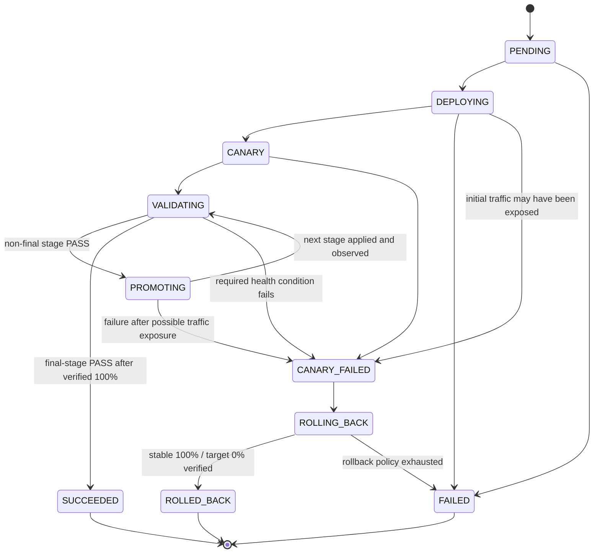

# Controller State Machine Design

**Status:** Draft for review  
**Scope:** Phase 1, Step 4 design only. No controller implementation is included.

This design operationalizes the corrected MVP contract in `ARCHITECTURE.md`, especially Sections 8 and 24, and requirements FR-14–FR-15, FR-19–FR-23, FR-26–FR-33, and NFR-01–NFR-03. Architecture Section 8 is the legal lifecycle graph; this document specifies the operational protocol. If residual wording conflicts, the corrected Section 24 contract governs, then this document's clarifications in Section 9, then Section 8. PostgreSQL remains the durable source of truth; Redis is not used.

## 1. Safety invariants

1. A lifecycle transition commits only when the stored status and revision equal the values the worker observed. A successful transition increments the revision and appends its event in the same PostgreSQL transaction.
2. There is one global controller coordinator. PostgreSQL stores its owner ID, lease expiry, and monotonically increasing fencing epoch. A worker must confirm its epoch and the deployment revision before each external operation.
3. Kubernetes mutations use the exact observed `metadata.resourceVersion` as a compare-and-swap precondition and carry the coordinator epoch, deployment revision, and operation ID as platform metadata. A stale resource-version conflict is never retried with a newly fetched version until ownership and revision have been checked again.
4. Persist stage intent before an external write. After a write or timeout, observe actual state before acknowledging or retrying it.
5. Health results are usable only for their deployment, target version, stage, revision, evaluation attempt, and persisted window. Missing, stale, partial, or unpersisted results never authorize promotion.
6. Traffic increases only after the current stage has been observed at its intended weights and every configured health condition has passed.
7. `SUCCEEDED` requires verified 100% target traffic followed by a fresh passing evaluation at the final stage and current revision. `ROLLED_BACK` requires verified stable 100% / target 0% traffic.
8. Lifecycle outcome and traffic safety are separate facts. `FAILED` does not assert that stable traffic is restored. Persist `trafficSafety` as `NOT_EXPOSED`, `EXPOSED`, `UNKNOWN`, or `VERIFIED_STABLE`, with the last authoritative observation and time. `SUCCEEDED` requires `EXPOSED`. `ROLLED_BACK` requires `VERIFIED_STABLE`. `VERIFIED_STABLE` is not a success-path value.
9. `SUCCEEDED`, `ROLLED_BACK`, and `FAILED` are terminal and immutable. A later attempt is a new deployment request.

### Coordinator ownership and external-write fencing

The logical PostgreSQL ownership record is a singleton row with `ownerId`, monotonically increasing `epoch`, `leaseExpiresAt`, and `renewedAt`. Acquisition locks the row, succeeds only when no live lease exists, and increments `epoch`; renewal is a conditional update on owner ID and epoch before expiry. Database time is authoritative. Ownership is global, while deployments for different applications may be scheduled concurrently within a configured bound; mutations for one deployment are serialized.

**Lease vs mutation timeout:** A worker may start a Kubernetes mutation only when remaining lease time, computed with database time, is strictly greater than that mutation's configured maximum client timeout. If remaining lease is not strictly greater, the worker must renew first and re-check. If renewal cannot establish remaining lease strictly greater than the timeout, the worker must not start the mutation, must cancel in-flight client work where possible, and must make no lifecycle claim. This document does not invent the lease length, renewal interval, or timeout values; they are required configuration. The relationship is the safety rule: a write that can outlive the lease must not be started. Kubernetes still does not enforce epoch; this bound only reduces (does not eliminate) the ownership-transfer race described in the protocol limit below.

Before persisting any operation that could set target weight above zero, set traffic safety to `UNKNOWN` in the same transaction as the stage intent. Only a fresh authoritative observation can change it to `EXPOSED` or `VERIFIED_STABLE`. This makes a crash or lost acknowledgment conservative: an unobserved nonzero write is never reported as `NOT_EXPOSED`.

If renewal fails, PostgreSQL is unavailable, or ownership cannot be confirmed, the worker cancels in-flight client work where possible, starts no more mutations, and makes no lifecycle claim. On takeover (new epoch), the new epoch invalidates the previous coordinator's authority regardless of whether the previous process has terminated. The new owner first reloads PostgreSQL and observes all managed resources. Before progressing a deployment, it applies the fencing barrier in Section 9.3 to each already-existing managed Kubernetes Deployment, Service, and Ingress for that deployment: write the new epoch and current deployment revision using that object's observed `resourceVersion`. A compare-and-swap conflict requires re-observation and reconciliation of the latest PostgreSQL intent. The fencing write uses a new `operationId` for the new epoch. Kubernetes does not treat the epoch annotation as admission enforcement.

Every Kubernetes write must follow this exact sequence:

1. Persist the operation intent in PostgreSQL using a conditional update for the current coordinator epoch, deployment revision, and operation ID. The `operationId` must follow Section 9.4 (new epoch requires a new `operationId`; same-epoch retries of the same intent reuse it).
2. Read the Kubernetes object and capture its UID and `metadata.resourceVersion`.
3. **After that read**, re-read/validate PostgreSQL ownership and deployment state. Continue only if the same coordinator epoch still owns work and the operation/revision remains current. This post-read check is mandatory: if Worker A reads the new resourceVersion after Worker B fenced the object, A sees the newer PostgreSQL epoch and discards its old operation.
4. Send one PATCH/UPDATE with that exact resourceVersion as the precondition and include the expected coordinator epoch, deployment revision, and operation ID in platform metadata. Disable client behavior that silently fetches a new resourceVersion and replays the patch.
5. On resourceVersion conflict, discard the prepared write, reload PostgreSQL and Kubernetes state, and start again only after validating current ownership. Never rebase stale intent onto a fresh version.
6. After the write response, revalidate PostgreSQL state before acknowledging it. Commit the acknowledgment/event only if the epoch, revision, and operation are still current; otherwise leave it unacknowledged for the new owner to observe and reconcile.

The ordering covers the reported fresh-version case: if B's fence is already applied before A reads, A's post-read PostgreSQL check rejects epoch 5; if B fences after A's read, the object version changes and A's exact-version update is rejected. If ownership changes after A's post-read check but before its request reaches Kubernetes, there is still a cross-system interval: A's request may be accepted before B's object fence is applied. B must fence, observe the actual object, and reapply the latest PostgreSQL intent before any further progress. If A's write wins first, B's resourceVersion update conflicts and it reloads/reconciles; B does not treat A's write as current merely because Kubernetes accepted it.

**Guarantees of this protocol:** a compliant stale worker that reads the post-fence object cannot submit its old operation after the mandatory ownership recheck; an update based on a pre-fence resourceVersion cannot overwrite the fence; stale work cannot commit an acknowledgment or lifecycle transition; and the new owner repairs divergence before advancing or reporting traffic safe.

**Limit of this protocol:** Kubernetes does not interpret an epoch annotation as a fence. ResourceVersion compare-and-swap alone does not reject an old epoch paired with a freshly read resourceVersion. Nor can PostgreSQL ownership and a Kubernetes write be made atomic here. A worker that bypasses the post-read check, or a request that races ownership transfer before the new owner's Kubernetes fence is applied, may still be accepted. The current design therefore guarantees detection, non-acknowledgment, and convergence before progress—not zero stale writes from the instant PostgreSQL ownership changes.

A stronger guarantee requires server-side Kubernetes enforcement of a monotonically increasing epoch, with handoff linearized against mutation admission, or an equivalent exclusive mutation gateway. Merely checking PostgreSQL from an admission webhook is insufficient if that check is not coordinated with admission/ownership transfer. Such enforcement is outside this design's current guarantee and needs an explicit architecture decision if required.

## 2. Lifecycle states and legal transitions



| Current state | Allowed next state | Required guard / evidence |
|---|---|---|
| `PENDING` | `DEPLOYING` | Request and application are valid; active reservation still belongs to this deployment. |
| `PENDING` | `FAILED` | A permanent pre-deployment failure is durably recorded. |
| `DEPLOYING` | `CANARY` | Target workload is observed ready alongside the stable version; initial below-100% traffic is applied and verified. |
| `DEPLOYING` | `FAILED` | Failure is terminal and the controller has authoritative evidence that target traffic was never exposed. |
| `DEPLOYING` | `CANARY_FAILED` | Initial traffic might have been exposed (including an unknown write outcome); persist failure and restore stable traffic. |
| `CANARY` | `VALIDATING` | Current stage weights are observed and the evaluation window can start. |
| `CANARY` | `CANARY_FAILED` | A required health condition or post-exposure operation fails; promotion is fenced and rollback begins. |
| `VALIDATING` | `PROMOTING` | A fresh, complete PASS exists for a non-final stage at the current revision. |
| `VALIDATING` | `SUCCEEDED` | Final 100% target traffic is verified, final-stage health has a fresh `COMPLETE`/`PASS` at the current revision, and `trafficSafety` is `EXPOSED`. |
| `VALIDATING` | `CANARY_FAILED` | A required condition fails or the configured missing-data policy classifies the evaluation as failed. |
| `PROMOTING` | `VALIDATING` | The next stage intent is applied and observed; the next evaluation starts only after verification. For the final stage, this is 100% followed by a final health window. |
| `PROMOTING` | `CANARY_FAILED` | Any permanent promotion failure after possible traffic exposure is recorded and rollback begins. |
| `CANARY_FAILED` | `ROLLING_BACK` | Failure reason and rollback intent are durably recorded before rollback writes. |
| `ROLLING_BACK` | `ROLLED_BACK` | Stable 100% / target 0% is observed for the current rollback generation. |
| `ROLLING_BACK` | `FAILED` | Rollback verification cannot complete within its configured retry/exhaustion policy; original failure and rollback outcome are retained. |

There is no `PROMOTING → SUCCEEDED` transition. After target traffic may have been exposed, a permanent failure cannot transition directly to `FAILED`; it enters `CANARY_FAILED` and attempts rollback. `ROLLING_BACK → ROLLED_BACK` is the only transition that may set `trafficSafety` to `VERIFIED_STABLE`, and it requires a fresh stable 100% / target 0% observation. If the rollback policy is exhausted, `ROLLING_BACK → FAILED` retains `EXPOSED` when the latest fresh observation still shows target traffic above zero, or `UNKNOWN` when current traffic cannot be determined; it must not claim `VERIFIED_STABLE`. If that verification succeeds, the lifecycle transition is `ROLLED_BACK`, not `FAILED`. `FAILED` alone never means traffic is safe. `SUCCEEDED` requires `trafficSafety` `EXPOSED` (see Section 9.6). `CANARY_FAILED` and `ROLLING_BACK` cannot return to promotion. Any transition not listed above is rejected. Every transition checks the expected status and revision, then increments revision and writes its event atomically.

The rollback generation is the deployment `revision` committed with the rollback intent. Verification and retries for that rollback are accepted only at that revision until a later legal transition increments it.

## 3. Durable stage sub-state

Lifecycle status describes the deployment as a whole. Each configured traffic stage separately records its operation progress:

```text
UNEVALUATED → INTENT_RECORDED → APPLYING → APPLIED → VALIDATING → PASSED
                                                   └────────────→ FAILED
```

For each stage the durable record identifies its ordinal, desired stable/target weights, operation identity, deployment revision, apply attempt, observed/applied weights, and validation attempt/window. `PASSED` is terminal for that stage. `FAILED` prevents advancement and enters the deployment failure path. Repeating an external write under the same coordinator epoch, deployment revision, and desired weights reuses the same `operationId`; it does not create a new deployment or skip a stage. A new coordinator epoch requires a new `operationId` before any subsequent mutation (Section 9.4).

### Authoritative traffic verification contract

Keep these values distinct:

| Value | Authority and meaning |
|---|---|
| Desired traffic | PostgreSQL stage intent: stable/target weights and the deployment revision/operation ID that requested them. |
| Applied configuration | Kubernetes Ingress resource accepted at its new resourceVersion/generation, plus AWS Load Balancer Controller reconciliation status where available. This proves configuration was accepted, not that the ALB is using it. |
| Observed traffic state | A fresh AWS Elastic Load Balancing v2 `DescribeRules` read of the listener rule mapped to the managed Ingress host/path and stable/target target-group ARNs. The forward action's target groups and configured weights must exactly match the desired stage. This verifies configured routing weights, not exact proportions of requests received. |

For every observation, persist the deployment revision, operation ID, Ingress UID and resourceVersion/generation, listener/rule ARN, stable/target target-group ARNs and weights returned, a digest of the observed forward action, and `observedAt`. The rule-to-Ingress mapping must be unambiguous from the AWS Load Balancer Controller-managed stack/rule and the Ingress host/path. An observation is fresh only if AWS reads occur after the matching Ingress update, both reads (separated by a configured stabilization interval) report the intended forward action, and a subsequent Kubernetes read confirms that the same Ingress UID, resourceVersion/generation, epoch, and operation ID remain current. Any intervening PostgreSQL revision or Ingress update invalidates the observation. If AWS returns multiple matching rules or cannot map target groups unambiguously, traffic is `UNKNOWN` and no gate passes.

Here, “observed traffic” means the current AWS ELBv2 listener-rule configuration, not a measured percentage of live requests and not a claim that each request follows an exact statistical share. This is the implementable gate available to the platform; logs/metrics may separately report observed request proportions, but they cannot replace the configured-rule check.

Only this fresh matching observation opens a health window, permits the next stage, satisfies the 100% success traffic gate, or proves rollback traffic restoration. The exact AWS SDK call details, pagination, account/region discovery, and target-group mapping implementation remain integration design work; the verification source and acceptance condition are fixed here.

### Health evaluation attempt protocol

An evaluation attempt has the logical identity `(deploymentId, targetImage, stageId/stageIndex, deploymentRevision, attemptId)`. Completion and result are orthogonal fields (Section 9.5). The durable record contains `windowStart`, planned `windowEnd`, `completion` (`RUNNING`, `COMPLETE`, or `INCOMPLETE`), result (`PASS`, `FAIL`, or `INDETERMINATE` when an outcome is recorded), and the signal observations/freshness evidence. `targetImage` and stage ordinal may be resolved through the immutable deployment and stage foreign keys, but the values used for a result must be captured or verified when accepting it.

1. Start the window only after the authoritative traffic observation passes. In one PostgreSQL transaction, create a new UUID attempt with completion `RUNNING`, the current revision/stage, a database-generated `windowStart`, and planned `windowEnd = windowStart + configuredDuration`; then record the stage's matching validation start. Do not set result to `PASS` at start.
2. Query only samples covering the persisted half-open interval `[windowStart, windowEnd)`. Those boundaries never move. `completedAt` records when the attempt was completed or abandoned; samples outside the planned interval cannot be mixed in. Use database time to decide whether `windowEnd` has been reached.
3. Completion and result are not interchangeable. Mark `COMPLETE` only after the planned interval has elapsed and the attempt is being closed with a recorded outcome. `PASS` is allowed only on `COMPLETE` when the full interval and every required signal are available and fresh. If the interval elapsed but required signals are missing, stale, or partial, record `COMPLETE` with `INDETERMINATE` or `FAIL` according to the configured missing-data policy, never `PASS`. Mark `INCOMPLETE` when the attempt is abandoned (process crash, ownership loss, revision change, or a new attempt superseding it); an `INCOMPLETE` attempt never authorizes promotion.
4. On coordinator takeover (new epoch), conditionally mark all `RUNNING` attempts belonging to previous epochs as `INCOMPLETE` with `completedAt` and the abandonment reason. Do not abandon attempts belonging to the current epoch. On process initialization within the same epoch, abandonment of `RUNNING` attempts requires evidence that the attempt's owner is no longer active. See Section 9.1 for the detailed protocol and the open design decision regarding same-epoch worker liveness.
5. Accept a late result only with a conditional write matching attempt ID, `RUNNING` completion, deployment revision, stage, and lifecycle `VALIDATING`. If the old attempt was marked incomplete, revision changed, or a new attempt started, the late result is discarded and cannot authorize promotion.

The current Prisma model has `windowStart`, nullable `windowEnd`, `isFresh`, result, stage ID, and deployment revision, but lacks an explicit attempt ID/completion status, planned window end semantics, and a completion/abandon timestamp or target-version snapshot. Add those fields (or an equivalent durable representation) before controller implementation. This is a schema/migration prerequisite, not part of this design-only change.

## 4. Reconciliation cycle

The controller is a level-based reconciler: persisted intent plus fresh observations determine the next action. Process memory and the last API response are never authoritative.

1. Acquire or renew the single global PostgreSQL coordinator record. Stop starting mutations if ownership is lost or cannot be confirmed, or if remaining lease is not strictly greater than the mutation timeout. On a new epoch, complete the Kubernetes fencing barrier (Section 9.3) before progressing deployments. On coordinator takeover (new epoch), abandon `RUNNING` health attempts belonging to previous epochs (Section 9.1) before accepting health results. Do not abandon attempts belonging to the current epoch. On process initialization within the same epoch, abandonment requires evidence that the attempt's owner is no longer active (see Section 9.1).
2. Find non-terminal deployments and process each deployment serially. Reload its current state, revision, stage, and latest durable result before deciding what to do.
3. Observe Kubernetes workload readiness and the current traffic configuration. Query the mapped ALB listener rule for observed forwarding weights; do not infer traffic from a write acknowledgment or Ingress spec alone.
4. Compare durable desired state with current observations. If they match, persist the matching acknowledgment conditionally. If they differ, persist an operation intent first, read the Kubernetes object, revalidate PostgreSQL ownership/state after the read, then issue one idempotent write with the captured epoch, revision, operation ID, and exact resourceVersion precondition.
5. Observe again after a write. Persist applied/verified state only if coordinator ownership and expected deployment revision still match. A resourceVersion conflict requires discarding the prepared write, reloading both stores, and validating ownership before any new attempt; never blind-replay against a newly read resourceVersion.
6. Start a uniquely identified health attempt only after authoritative stage traffic verification. Accept its result only if attempt ID, deployment/version/stage/revision/window, and lifecycle `VALIDATING` still match.
7. On a non-final `COMPLETE`/`PASS`, atomically persist the next stage intent and transition to `PROMOTING`. On final `COMPLETE`/`PASS` after 100% is verified, transition from `VALIDATING` to `SUCCEEDED` with `trafficSafety` `EXPOSED`. If target traffic may have been exposed, any permanent deployment/health/promotion failure records its cause, enters `CANARY_FAILED`, and begins rollback. `FAILED` before rollback is allowed only when the controller proves target traffic was never exposed.
8. Repeat observation and reconciliation until a terminal state or a dependency/policy condition requires a durable wait or failure.

Different applications may be scheduled with bounded concurrency. Mutations for one deployment remain serialized. The coordinator is PostgreSQL-owned; Redis is absent.

## 5. Crash and restart recovery

On startup or after work interruption, reload every non-terminal deployment and observe external state before writing:

| Crash point | Recovery action |
|---|---|
| Before durable intent | No external action is assumed. Recompute from lifecycle and stage records. |
| After intent, before external write | Observe first. If actual state differs and revision is current, apply the same intent. |
| External write succeeded, acknowledgment not committed | Observe the relevant Kubernetes resource and traffic generation. If it matches, record acknowledgment; otherwise retry the same idempotent action under the current revision. |
| During health query | On coordinator takeover (new epoch), mark all `RUNNING` attempts belonging to previous epochs as `INCOMPLETE` with the abandonment reason. Do not abandon attempts belonging to the current epoch. On process initialization within the same epoch, abandonment requires evidence that the attempt's owner is no longer active (see Section 9.1). Accept only a `COMPLETE` result for the persisted attempt/window, and accept `PASS` only as specified in Section 9.5. Never infer `PASS` from partial data or from an `INCOMPLETE` attempt. Re-verify traffic, then start a new attempt and window. |
| PASS observed but next transition not committed | Reload. If the PASS is durable and still matches state/revision, conditionally continue; otherwise discard it and reevaluate. |
| Promotion racing with failure/rollback | The failure transition increments the revision. A stale promotion or health result fails its compare-and-set guard and cannot write traffic or advance state. |
| During rollback | Reload the persisted reason and rollback intent; observe current traffic, reapply if needed, and verify before `ROLLED_BACK`. Exhaustion becomes `FAILED` with both original and rollback details. |

## 6. Failure handling

| Failure | Required behavior |
|---|---|
| PostgreSQL unavailable | Stop initiating mutations that require unverified ownership/revision; do not promote or declare success. Preserve the last committed state. After recovery, reload PostgreSQL, re-observe Kubernetes/ALB, then persist the recovery decision. Do not claim safety while traffic is unknown. |
| Kubernetes API unavailable | Preserve durable state and do not promote or claim readiness. Retry observation/reconciliation under policy. Before target exposure, exhaustion may become `FAILED`; after possible exposure, initiate/remain in rollback. If restoration cannot be observed before rollback exhaustion, `FAILED` has traffic safety `UNKNOWN` and an operational alert is required. |
| Target pod not ready or restarting | Require the configured target Deployment generation/readiness conditions before initial traffic. Readiness/restart failures block promotion; after target exposure, a classified permanent failure enters `CANARY_FAILED` and rollback. |
| Prometheus missing, stale, partial, or unavailable | Never record `PASS`. If the process or ownership is gone, mark the attempt `INCOMPLETE`. If the window elapsed under a live attempt, record `COMPLETE` with `INDETERMINATE` or `FAIL` per missing-data policy. Retry only within that policy. Exhaustion after exposure records the evaluation failure and starts rollback. |
| ALB/traffic observation unavailable or ambiguous | Set traffic safety `UNKNOWN`. Do not start/complete a health window, advance, claim a current observed percentage, declare success, or claim rollback complete. Retry within policy; after exposure, continue rollback attempts when possible. On exhaustion, persist `FAILED`/unknown and alert when PostgreSQL is available. |
| Traffic differs from intent | Observe the current resourceVersion and ALB rule, then reconcile the latest current-revision intent. Do not replay an old stage blindly. |
| Rollback action or verification fails | Remain `ROLLING_BACK` while its bounded policy permits. If stable 100% / target 0% is freshly verified, transition to `ROLLED_BACK` with `VERIFIED_STABLE`. On exhaustion without that verification, transition to `FAILED`, retaining the canary cause, rollback outcome, and `EXPOSED` or `UNKNOWN`. |
| Stale worker, write, or health result | Reject by coordinator epoch, deployment revision/state, evaluation attempt identity, or Kubernetes resourceVersion precondition. Reload and observe; never auto-refresh the precondition and replay stale intent. |

`FAILED` describes deployment completion, not traffic safety. `trafficSafety` is updated independently from authoritative observations: `NOT_EXPOSED` only before any nonzero target write is possible and with verified zero target weight; `EXPOSED` when the latest fresh observation shows target traffic above zero (including verified 100% target, which is required for `SUCCEEDED`); `VERIFIED_STABLE` only for a fresh stable-100/target-0 observation and only with lifecycle `ROLLED_BACK`; otherwise `UNKNOWN`. Evaluate current safety at reconcile or authorized read time from the stored observation and its timestamp; when the observation ages beyond the configured freshness bound, current safety is `UNKNOWN` while the stored last observation remains as history. Do not background-rewrite safety without coordinator ownership. Keep the last observation separately so UNKNOWN does not erase useful evidence. `FAILED/EXPOSED` and `FAILED/UNKNOWN` are terminal for automation and require an explicit operational alert and operator assessment; neither may be shown as safely restored. Persist uncertainty and emit an operational alert whenever traffic cannot be determined after exposure or rollback exhaustion. `SUCCEEDED/EXPOSED` is the success pair; `SUCCEEDED/VERIFIED_STABLE` is invalid.

## 7. Configuration contract

Every dependency policy is bounded by both attempt count and maximum elapsed time, with backoff and retry classification. Values are required configuration; this design does not invent production numbers.

| Configuration | Required contract | Exhaustion outcome |
|---|---|---|
| Kubernetes observation and operation retries | Separate read/write limits; retry only transient/network, throttling, and resourceVersion conflicts after reload/revalidation. Permanent validation/RBAC errors are not blindly retried. Remaining coordinator lease (database time) must be strictly greater than the configured maximum mutation timeout before starting a write; renew first if not. | Before exposure: `FAILED`. After possible exposure: rollback path; if state cannot be observed/restored, `FAILED` with safety `UNKNOWN` and alert. |
| Prometheus missing-data policy | Evaluation window, maximum missing-data wait, sample freshness bound, and required signal set. An attempt must cover its whole persisted window. | `INCOMPLETE` attempts and `INDETERMINATE` outcomes never pass. After exposure, exhausted required data is a canary failure and initiates rollback. |
| ALB observation policy | Rule discovery/mapping, read retry/timeout bounds, freshness check, and required matching observation contract from Section 3. | No gate passes. Before exposure, remain pre-traffic or fail; after exposure, rollback cannot complete without observation and failure is marked `UNKNOWN` if exhausted. |
| Rollback policy | Bounded retries for Ingress correction and authoritative rule observation; preserve original failure separately from rollback errors. | Fresh stable 100% / target 0% → `ROLLED_BACK` / `VERIFIED_STABLE`. Exhaustion without that verification → `FAILED` with `EXPOSED` or `UNKNOWN`. |
| Workload readiness | Require current Deployment generation observed, all requested replicas available/ready, and configured restart/unhealthy conditions satisfied before first target exposure. Values and grace periods are explicit configuration. | Pre-exposure exhaustion is `FAILED`; after any possible exposure, rollback. |
| Health window/freshness | Window duration, required signal coverage, maximum sample age, and attempt protocol in Sections 3 and 9.5. | `INCOMPLETE` never passes. `COMPLETE` may be `PASS`, `FAIL`, or `INDETERMINATE`; never synthesize a `PASS`. Post-exposure exhaustion initiates rollback. |
| Controller concurrency | Positive maximum active deployments processed concurrently; at most one mutator per deployment. Coordinator ownership is global. | Work beyond the bound remains durably pending; no unbounded in-memory queue is authoritative. |
| Coordinator lease | Lease duration, renewal interval, and per-mutation Kubernetes client timeout. Remaining lease must be strictly greater than the mutation timeout before each write. Values are required configuration; none are invented here. | Cannot confirm ownership: start no mutation; no lifecycle claim. |

No dependency outage requires a database state write while PostgreSQL is unavailable. The worker preserves the last committed status and resumes its decision only after it can reload state and observe external systems.

## 8. Review items before implementation

The safety contracts are now explicit. Before implementation, review the proposed PostgreSQL coordinator-row addition, traffic-safety persistence fields, evaluation-attempt schema additions, ALB rule-to-Ingress mapping, and configuration source/values. These require schema/configuration decisions and migrations, but no controller code is authorized by this document.

The current protocol's guarantee is deliberately bounded as described above: post-read ownership validation handles a stale worker that sees a newer fence, exact resourceVersion checks reject older snapshots, and the new owner reconciles before advancing. It does not provide server-enforced rejection of every stale epoch at Kubernetes admission. If that stronger guarantee is required, decide on and design an epoch-aware Kubernetes admission/mutation enforcement mechanism before implementation; do not treat an epoch annotation as enforcement.

## 9. Design clarifications

This section resolves six specific design clarifications required before controller implementation.

### 9.1 Abandoned health attempts

**Normative rule:** Health evaluation attempt abandonment must distinguish between coordinator takeover (new epoch) and process initialization within the same epoch.

**Coordinator takeover (new epoch):** When a new coordinator epoch takes ownership, the new epoch invalidates the previous coordinator's authority. Health attempts associated with previous epochs must be conditionally marked `INCOMPLETE` with a `completedAt` timestamp, and late results from those attempts must be rejected even if the old process is still running. The abandonment operation must target only attempts belonging to previous epochs; it must not indiscriminately abandon a legitimate `RUNNING` attempt belonging to the current epoch. Record the abandonment reason (epoch change). Ensure the update cannot overwrite an attempt that has already reached a terminal completion status (`COMPLETE` or `INCOMPLETE`).

**Process initialization within the same epoch:** Process initialization alone is not evidence that another worker's attempt is abandoned. Do not mark another worker's `RUNNING` attempt `INCOMPLETE` without evidence that the attempt's owner is no longer active. The coordinator lease proves the coordinator process is alive, but it does not prove that individual health evaluation workers are alive or dead. If health evaluation is performed by the same process as the coordinator, process restart may legitimately abandon its own attempts. If health evaluation is performed by separate worker processes, the current architecture does not define a durable worker identity or liveness mechanism to distinguish a crashed worker from a live worker.

**Open design decision:** The current architecture defines a single global coordinator with an owner ID, epoch, and lease. It does not define individual health worker identity, heartbeats, or liveness tracking. Therefore, for same-epoch process initialization, the protocol cannot safely determine whether a `RUNNING` attempt belongs to a live worker or a crashed worker. The safe behavior is:
- If health evaluation is performed by the coordinator process itself, the process may abandon its own `RUNNING` attempts on restart because it knows it is the only worker.
- If health evaluation is performed by separate worker processes, the current architecture does not provide enough information to determine worker liveness safely. A process must not abandon another worker's `RUNNING` attempt without a defined durable worker identity and liveness mechanism. This requires an explicit architecture decision before implementation.

**Procedure for coordinator takeover (new epoch):**
1. After acquiring the new coordinator epoch, query all `HealthEvaluation` records with completion `RUNNING` and coordinator epoch less than the new epoch.
2. For each such record, conditionally update completion to `INCOMPLETE` and set `completedAt` only if the record is still `RUNNING` (compare-and-set). Include the abandonment reason in the record.
3. Do not abandon attempts with coordinator epoch equal to the new epoch; those belong to the current authority and must not be invalidated.
4. Retain the original `windowStart`, planned `windowEnd`, and other diagnostic fields.
5. Never resume or combine samples from an `INCOMPLETE` attempt.
6. After abandonment, re-verify current traffic state and create a new attempt with a new attempt ID and new window before accepting any health result.

**Procedure for process initialization (same epoch):**
1. If health evaluation is performed by the coordinator process itself, the process may query and conditionally abandon its own `RUNNING` attempts on restart using the same conditional update procedure as coordinator takeover.
2. If health evaluation is performed by separate worker processes, do not abandon `RUNNING` attempts without a defined durable worker identity and liveness mechanism. The current architecture does not provide this mechanism.
3. Late results from abandoned attempts cannot authorize promotion (see Section 3, point 5).

**Concurrency and recovery guarantees:**
- Abandonment updates are conditional using compare-and-set on completion status. This is safe under concurrent recovery because two processes cannot both successfully update the same record from `RUNNING` to `INCOMPLETE`.
- A stale worker that attempts to submit a result for an abandoned attempt is rejected by the conditional write guard (Section 3, point 5) because the completion status no longer matches `RUNNING`.
- Even if a stale worker from a previous epoch is still running and submits a result, the result is rejected because the attempt is marked `INCOMPLETE` and the epoch no longer matches the current authority.
- A replacement attempt uses a new attempt identity and follows the approved health-window rules in Section 3.
- The process must not infer that a health window passed merely because its worker disappeared. An abandoned or incomplete window never authorizes promotion.

**Schema prerequisite:** The current Prisma model lacks explicit fields for coordinator epoch, completion status (`RUNNING`, `COMPLETE`, `INCOMPLETE`), attempt ID, and `completedAt` timestamp. These fields (or an equivalent durable representation) must be added to the schema before controller implementation. See Section 3 for the schema addition note.

**Consistency check:** This rule aligns with Section 1 (coordinator ownership) and Section 3 (evaluation attempt protocol). It corrects the previous incorrect claim that a new epoch proves the previous owner is no longer active. The new epoch invalidates the previous coordinator's authority regardless of whether the previous process has terminated. The abandonment operation targets only attempts belonging to previous epochs. The distinction between coordinator takeover (invalidate previous epoch's attempts) and same-epoch initialization (requires worker liveness evidence) is now explicit. The open design decision reflects the current architecture's limitation in tracking individual worker liveness.

### 9.2 Lease safety relationship

**Normative rule:** A worker may start a Kubernetes mutation only when the remaining coordinator lease duration, computed using database time at the moment of the operation decision, is strictly greater than the configured maximum client timeout for that mutation. If remaining lease is not strictly greater, the worker must renew the lease first and re-check. If renewal cannot establish remaining lease strictly greater than the timeout, the worker must not start the mutation, must cancel in-flight client work where possible, and must make no lifecycle claim.

**Failure case:** If a worker starts a long-running Kubernetes mutation when the lease expires before the mutation can complete, the worker may lose ownership during the operation. The new owner may fence the same object, but the old worker's in-flight write could still be accepted, leading to divergent state or unsafe traffic configuration.

**Relationship specification:** The required relationship is: `remaining_lease_duration > maximum_mutation_timeout`. The document does not invent numerical values for lease duration, renewal interval, or timeout. These are required configuration values to be provided at deployment time. The safety rule is the strict inequality, not any specific duration.

**Procedure:**
1. Before initiating any Kubernetes mutation, compute `remaining_lease = leaseExpiresAt - database_time_now()`.
2. Compare `remaining_lease` against the configured `maximum_mutation_timeout` for the operation type.
3. If `remaining_lease <= maximum_mutation_timeout`, first attempt lease renewal using the conditional update protocol.
4. After renewal, recompute `remaining_lease` and re-check the inequality.
5. If the inequality cannot be satisfied, do not start the mutation; preserve the last committed state and await ownership recovery.

**Consistency check:** This rule aligns with Section 1 (safety invariants) and Section 7 (configuration contract). It does not invent numerical values as instructed. The Kubernetes limitation (that Kubernetes does not treat the epoch annotation as admission enforcement) remains explicit in Section 1.

### 9.3 Fenced objects

**Normative rule:** The ownership/revision/operation validation protocol (resourceVersion compare-and-swap with epoch, deployment revision, and operationId metadata) must be applied to all Kubernetes mutations that change deployment-critical state. The fenced objects are:

- **Deployment resources** for the target and stable versions (CREATE, UPDATE, SCALE operations)
- **Service resources** for the target and stable versions (CREATE, UPDATE operations)
- **Ingress resources** that define weighted routing to stable/canary target groups (PATCH/UPDATE operations for weights, host/path configuration)

Operations that do not mutate deployment-critical state (e.g., read-only observations, label updates that do not affect routing, status checks) do not require the full fencing protocol but must still use appropriate optimistic concurrency preconditions where applicable.

**Failure case:** Without fencing, a stale worker could overwrite a newer revision's resource state, causing divergent desired/actual state or unsafe traffic configuration. The fencing protocol ensures that only the current owner with the current deployment revision can mutate deployment-critical objects.

**Fencing procedure:**
1. Before any mutation on a fenced object, persist the operation intent in PostgreSQL with the current coordinator epoch, deployment revision, and operation ID.
2. Read the Kubernetes object and capture its UID and `metadata.resourceVersion`.
3. Re-validate PostgreSQL ownership and deployment state after the read.
4. Issue the mutation with the exact resourceVersion as a precondition and include epoch, revision, and operationId in platform metadata.
5. On resourceVersion conflict, discard the write, reload both stores, and re-validate ownership before retrying.

**Consistency check:** This specification aligns with Section 1 (safety invariants) and the ownership fencing protocol. It explicitly lists the objects and operations, resolving the ambiguity. The distinction between read-only and mutating operations is preserved.

### 9.4 Operation identity

**Normative rule:** A new coordinator epoch requires a new `operationId` before any subsequent Kubernetes mutation. Retries within the same coordinator epoch for the same stage intent must reuse the existing `operationId`. A new stage intent always requires a new `operationId` regardless of epoch.

**Failure case:** If the same `operationId` is reused across epochs, a stale worker from the old epoch could accidentally match a newer epoch's operation record, bypassing the fencing check. If retries within the same epoch generate new `operationId` values, the system cannot distinguish idempotent retries from distinct operations.

**Epoch change rule:** When the coordinator epoch increments (ownership transfer), the new owner must generate a new `operationId` for any mutation on a deployment-critical object. The new owner first applies the fencing barrier (Section 1) using the new epoch and a new `operationId` before progressing the deployment.

**Same-epoch retry rule:** If a mutation fails transiently (network error, resourceVersion conflict after reload/revalidation) and the coordinator epoch and deployment revision remain unchanged, the worker may retry the same intent using the existing `operationId`. This preserves idempotency and allows the system to recognize the retry as the same logical operation.

**New stage rule:** When transitioning to a new canary stage (persisting a new stage intent), the worker must generate a new `operationId` regardless of whether the epoch has changed. This is because each stage represents a distinct logical operation with different desired weights.

**Consistency check:** This rule aligns with Section 1 (operation intent persistence) and Section 3 (stage sub-state). It resolves the ambiguity about when to generate new operation IDs without contradicting existing behavior.

### 9.5 Health completion and result

**Normative rule:** Health evaluation attempt completion status (`RUNNING`, `COMPLETE`, or `INCOMPLETE`) and health outcome (`PASS`, `FAIL`, or `INDETERMINATE`) are orthogonal dimensions. They must not be treated as interchangeable.

- **Completion status** describes whether the evaluation window has finished or was abandoned:
  - `RUNNING`: The window is in progress; no outcome is authoritative.
  - `COMPLETE`: The planned window interval has elapsed and the attempt is being closed with a recorded outcome.
  - `INCOMPLETE`: The attempt was abandoned (process crash, ownership loss, revision change, or superseded by a new attempt); no outcome authorizes promotion.

- **Health outcome** describes the result of a completed evaluation:
  - `PASS`: All required signals passed with fresh data over the full interval.
  - `FAIL`: One or more required signals failed the configured condition.
  - `INDETERMINATE`: Required signals were missing, stale, or partial; the evaluation cannot conclusively pass or fail.

**Failure case:** If completion and outcome are conflated, the system could accept a `PASS` for an incomplete window (partial data) or treat an `INCOMPLETE` attempt as if it had a definitive outcome, leading to unsafe promotion or incorrect failure classification.

**Normative rules:**
1. Mark `COMPLETE` only after the planned `windowEnd` has been reached and the attempt is being closed with a recorded outcome.
2. `PASS` is allowed only on a `COMPLETE` attempt when the full interval and every required signal are available and fresh.
3. If the interval elapsed but required signals are missing, stale, or partial, record `COMPLETE` with `INDETERMINATE` or `FAIL` according to the configured missing-data policy; never record `PASS`.
4. Mark `INCOMPLETE` when the attempt is abandoned (process crash, ownership loss, revision change, or a new attempt superseding it); an `INCOMPLETE` attempt never authorizes promotion.
5. A `RUNNING` attempt cannot have an authoritative outcome; any outcome recorded while `RUNNING` is provisional and must be discarded if the attempt is later marked `INCOMPLETE`.

**Consistency check:** This clarification aligns with Section 3 (evaluation attempt protocol) and Section 5 (crash and restart recovery). It explicitly states the orthogonality that was implied but not fully defined. No contradictions with existing rules exist.

### 9.6 Successful deployment safety

**Normative rule:** A deployment transitioning to `SUCCEEDED` must have `trafficSafety` value `EXPOSED`, not `VERIFIED_STABLE`. The required value is `EXPOSED` because success means the target version is currently receiving traffic (verified 100% target traffic). `VERIFIED_STABLE` is reserved for `ROLLED_BACK` deployments, where stable traffic has been restored.

**Distinction:**
- `EXPOSED`: The latest fresh observation shows target traffic above zero (including verified 100% target for success). This indicates the new version is currently serving production traffic.
- `VERIFIED_STABLE`: The latest fresh observation shows stable 100% / target 0% traffic. This indicates traffic has been restored to the previous healthy version after rollback.
- `NOT_EXPOSED`: Target traffic has never been exposed or is verified as zero with no prior exposure.
- `UNKNOWN`: Traffic state cannot be determined from current observations (observation unavailable, ambiguous, or stale).

**Failure case:** If `SUCCEEDED` required `VERIFIED_STABLE`, it would imply that success means traffic is restored to the stable version, which contradicts the definition of a successful canary promotion. Conversely, if `ROLLED_BACK` used `EXPOSED`, it would incorrectly suggest that the failed canary is still receiving traffic.

**Normative rules:**
1. `SUCCEEDED` requires `trafficSafety` = `EXPOSED` with a fresh observation showing verified 100% target traffic and a fresh passing health evaluation at the final stage.
2. `ROLLED_BACK` requires `trafficSafety` = `VERIFIED_STABLE` with a fresh observation showing stable 100% / target 0% traffic.
3. `FAILED` may retain `NOT_EXPOSED`, `EXPOSED`, or `UNKNOWN` according to the last fresh observation; it must not be presented as restored stable traffic.
4. If rollback verification observes stable 100% / target 0%, the lifecycle transition is `ROLLED_BACK`, not `FAILED`.
5. `SUCCEEDED/VERIFIED_STABLE` is an invalid combination; a successful deployment cannot have stable-only traffic.

**Consistency check:** This rule aligns with Section 1 (safety invariants) and Architecture Section 8. It explicitly defines the required `trafficSafety` value for `SUCCEEDED` as `EXPOSED`, which is consistent with the requirement that success means the target version is serving 100% of traffic. No contradictions with existing rules exist.
